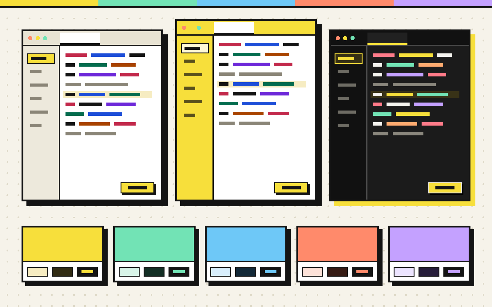

# Neo Brutalism for Orca



High-contrast Neo Brutalism and pop-art color themes for [Orca](https://github.com/stablyai/orca): crisp ink borders, warm paper and deep ink canvases, a bold signal-yellow frame variant, and five vibrant signal accents (**Yellow**, **Mint**, **Sky**, **Coral**, **Lavender**) with matching editor syntax highlighting and terminal ANSI palettes.

## Install

- [Open in Orca](https://orca.dev/plugins/feifeifeimoon.neo-brutalism?catalog=community)
- Or install directly via CLI:

```sh
orca plugin install feifeifeimoon/orca-neo-brutalism
```

Then open **Settings → Appearance** to pick your preferred Light, Dark, Editor, and Terminal theme.

## Included Themes

### App & Editor Themes (11)

| Theme | Mode | Frame | Signal |
| --- | --- | --- | --- |
| **Brutal Yellow** | Light | Warm Paper | Yellow |
| **Brutal Yellow Frame** | Light | Signal Yellow Sidebars & Tab Bar | Yellow |
| **Brutal Dark Yellow** | Dark | Pitch Ink | Yellow |
| **Brutal Mint** | Light | Warm Paper | Mint |
| **Brutal Dark Mint** | Dark | Pitch Ink | Mint |
| **Brutal Sky** | Light | Warm Paper | Sky |
| **Brutal Dark Sky** | Dark | Pitch Ink | Sky |
| **Brutal Coral** | Light | Warm Paper | Coral |
| **Brutal Dark Coral** | Dark | Pitch Ink | Coral |
| **Brutal Lavender** | Light | Warm Paper | Lavender |
| **Brutal Dark Lavender** | Dark | Pitch Ink | Lavender |

### Terminal Themes (6)

- **Brutal Light** (Light)
- **Brutal Dark Yellow / Mint / Sky / Coral / Lavender** (Dark)

## Local Development

```sh
orca plugin dev load .
```

## License

MIT
